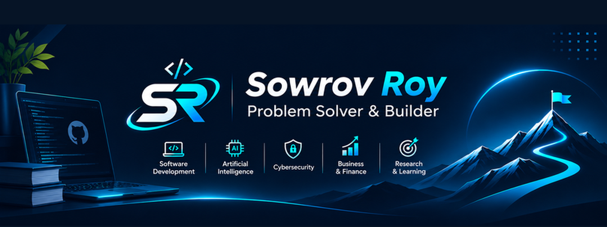

<!-- ===================================================== -->
<!-- SOWROV ROY | GITHUB PROFILE README                    -->
<!-- Brand: Deep Navy #061426 | Cyan #00D9FF | Blue #1677FF -->
<!-- ===================================================== -->

<!-- HERO BANNER -->

  

<!-- INTRODUCTION -->
<h1 align="center">Hey, I'm Sowrov Roy 👋</h1>

<h3 align="center">
  Problem Solver & Builder
</h3>

  

  
  
  

---

<!-- ABOUT ME -->
<h2>👨‍💻 About Me</h2>

I'm a Computer Science student passionate about technology, problem-solving, and building practical solutions to real-world challenges.

I enjoy exploring how software, innovation, and emerging technologies can create meaningful value for people and businesses.

- 🎓 Studying Computer Science & Engineering
- 💡 Interested in solving real-world problems through technology
- 🌱 Currently exploring modern frontend and full-stack development
- 🔍 Curious about AI, cybersecurity, business, and innovation
- 🚀 Long-term vision: Building technology-driven products and businesses

---

<!-- TECH STACK -->
<h2>🛠️ Technologies & Tools</h2>

<h3>Languages & Development</h3>

  

<h3>Tools & Platforms</h3>

  

---

<!-- CURRENT FOCUS -->
<h2>🌱 Currently Learning & Exploring</h2>

<table>
  <tr>
    <td width="50%">
      <h3 align="center">💻 Software Development</h3>
      

        React.js · JavaScript · Node.js · Full-Stack Development
      

    </td>
    <td width="50%">
      <h3 align="center">🧠 Technology & Innovation</h3>
      

        Artificial Intelligence · Cybersecurity · Software Architecture
      

    </td>
  </tr>
</table>

---

<!-- GITHUB STATISTICS -->
<h2>📊 GitHub Statistics</h2>

  
  

  

---

<!-- TROPHIES -->
<h2>🏆 GitHub Achievements</h2>

  

---

<!-- PROJECTS -->
<h2>🚀 Featured Projects</h2>

  <i>Building practical projects and improving my development skills.</i>

<!-- Replace these examples with your real project repositories -->

<table>
  <tr>
    <td width="50%">
      <h3 align="center">Project 01</h3>
      

        Add your best project here.
      

      

        <a href="https://github.com/iamsowrovroy">
          View Repository →
        </a>
      

    </td>
    <td width="50%">
      <h3 align="center">Project 02</h3>
      

        Add another interesting project here.
      

      

        <a href="https://github.com/iamsowrovroy">
          View Repository →
        </a>
      

    </td>
  </tr>
</table>

---

<!-- AREAS OF INTEREST -->
<h2>💡 Areas of Interest</h2>

  
  
  
  
  
  

---

<!-- VISION -->
<h2>🎯 My Vision</h2>

  <b>To become a technology-driven entrepreneur.</b>

  I want to build meaningful products, develop innovative solutions,
  and create businesses that solve real-world problems.

---

<!-- CONNECT -->
<h2 align="center">🤝 Let's Connect</h2>

  I'm always interested in connecting with people who love technology,
  business, innovation, and problem-solving.

  
  

---

  

  <b>Always Learning. Always Building. Always Solving.</b>

  <i>© 2026 Sowrov Roy. All Rights Reserved.</i>

